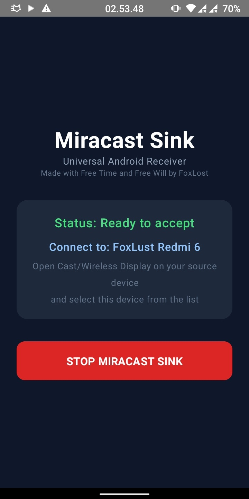
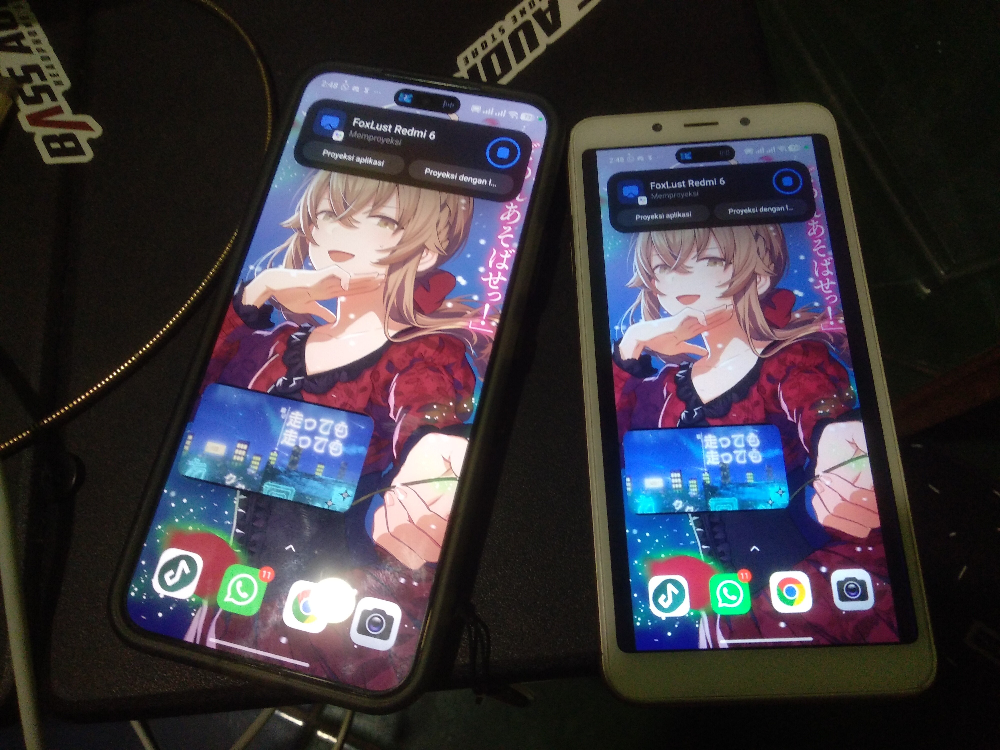

# Universal Miracast Sink

A Miracast (Wi-Fi Display) receiver for rooted Android 10+ devices. The APK runs with its own application UID; a narrow root bridge is started only during a sink session. Platform signing, system-app installation, and LSPosed are not required.

**Current version**: v1.22 (versionCode 23)

## Little story about this project:
I have Xiaomi Pad 6 that has Miracast Sink mode built in to devices (com.xiaomi.miralink) that works on newer android 14 (HyperOS 2) and i want to implement that so my Second devices can become like viewfinder when using camera and another,
so i try to get many data like decompile apk from xiaomi miralink, decompile firmware from my android box (x96 mini) that has firmware android 7 and android 9 build that support Miracast Sink, and capture the wifi direct communication with
my usb wifi that support monitoring mode, after that i spend roughly 1 week vibe coding the app with all the data that i can find, try using root methode send command to android hidden api, using xposed to hook system_server, and
try using magisk module to put the apk on system so the app can get android hidden api directly, and that finally the app working and my device can be datacted as miracast sink display, so here the project i publish

## Screenshots

| Dashboard | Streaming |
|-----------|-----------|
|  |  |

## Architecture

```
MainActivity (Jetpack Compose Dashboard)
    |
    v
MiracastService (Foreground Service)
    |-- P2pManager ----- normal-app P2P discovery and group management
    |   |-- P2pReceiver ---- BroadcastReceiver for P2P state changes
    |   `-- RootBridgeClient - private session-owned stdio processes
    |       |-- RootFrameworkBridge - WFD/listen/STA under verified UID 1000
    |       |-- RootPlayerBridge - fixed UID-0 ActivityManager shell launch
    |       `-- RootSocketBridge - allowlisted supplicant commands and ARP
    |
    |-- AdaptiveSessionController -- generation/attempt ownership and bounded retries
    |   `-- RtspConnection / RtspSessionEngine -- outbound source connection, WFD M1–M7
    |
    `-- PlayerActivity -- Media playback (immersive fullscreen)
        |-- RtpReceiver ---- bounded UDP RTP reordering and loss recovery
        |-- TsDemuxer ------ MPEG-TS access units + LPCM audio PTS
        |-- MediaDecoderPipeline -- H.264 + audio-master presentation clock
        `-- UIBC session ----- optional generation-owned Generic/HIDC touch TCP path
```

## Protocol Flow

WFD RTSP roles are independent of P2P Group Owner negotiation: **the sink opens
TCP to the source**, using its advertised control port or the standard default
7236. The sink does not expose an inbound RTSP server.

1. Discover a WFD **source-capable** peer, negotiate P2P, and wait for usable peer/interface/IP information.
2. Connect to the source with bounded retries during its control-server startup window.
3. **M1 → M2:** acknowledge the source's OPTIONS, then send sink OPTIONS and wait for its matching success response.
4. **M3:** return requested capabilities from one session snapshot, with the RTP port already bound and formats reported by local AVC decoders.
5. **M4:** accept only supported media, UDP ports, and a valid source presentation URL. Split selections accumulate only after successful acknowledgement.
6. **M5 → M6 → M7:** acknowledge the source's SETUP trigger before sending SETUP; validate Session and UDP Transport; send PLAY. The **first successful PLAY** starts media.
7. Answer source-owned **M16** keepalives. Acknowledge control triggers before sending PAUSE/PLAY/TEARDOWN; close after teardown completion or its deadline.

UIBC is independent of video playback: it requires local opt-in advertised in
M3, an accepted source-selected capability/TCP endpoint, and explicit enablement.
The sink does not force input when the source declines or lacks UIBC.

GO intent defaults to `0`, with a configurable fallback. It influences P2P
negotiation only; neither GO ownership nor TCP direction identifies the source
as Windows or Android. Duplicate PLAY is disabled by default and remains an
explicit source-specific workaround.

### Session interoperability (v1.15)

SETUP must supply the source's Session ID and a matching UDP Transport. That
opaque ID is retained for every sink PLAY/PAUSE/TEARDOWN/recovery request;
it is never replaced by a later response.

WFD v2.1 Appendix E.1 (page 186) shows a successful PLAY response without
Session and explicitly permits source requests, including M16 keepalives, to
omit it. Such omissions are accepted on the established control connection.
Responses still require a matching outstanding CSeq and successful status;
any supplied empty or different Session is rejected. A valid headerless M16
refreshes the negotiated keepalive deadline, but arbitrary parameter updates
do not. This policy is independent of Windows/Android identification and P2P
GO/client ownership; display, transport selection and UIBC encoding are unchanged.

Regression coverage includes omitted and incorrect Session headers, CSeq
correlation, Session preservation through control requests, and M16 expiry.
Host smoke exercises the production controller/RTSP engine over real loopback
TCP and bound UDP ports, including Windows → Android → Windows with both P2P
role models. It does not establish physical Wi-Fi, decoder or touch behavior.


### Interoperability target and references

The target is the **WFD R1 P2P, H.264, LPCM, unicast UDP** path. A “compatible
with every device” guarantee is not possible: Wi-Fi firmware, vendor APIs,
SELinux/root policy, codec metadata and source input permissions differ. HDCP,
AAC/HEVC and R2 infrastructure/transport switching are not implemented or claimed.

- [Wi-Fi Display Technical Specification v2.1](https://raw.githubusercontent.com/wiki/albfan/miraclecast/files/Wi-Fi_Display_Technical_Specification_v2.1_0.pdf), public mirror of the WFA specification: §§4.5.4, 4.11, 6.1.3, 6.4–6.6.
- [AOSP experimental WFD sink](https://android.googlesource.com/platform/frameworks/av/+/android-4.2.2_r1.2/media/libstagefright/wifi-display/sink/WifiDisplaySink.cpp), cross-check only; its placeholder URL and early SETUP are not adopted.
- [Android MediaCodecList](https://developer.android.com/reference/android/media/MediaCodecList) and [VideoCapabilities](https://developer.android.com/reference/android/media/MediaCodecInfo.VideoCapabilities): reported format support is not a guarantee of sustained real-time decoding performance.


## Adaptive session lifecycle

Each sink start creates a generation-scoped session. `P2pManager` serializes framework LISTEN, extended LISTEN, discovery, and the optional supplicant monitor. A group-started indication is only a candidate: readiness polling refreshes group info followed by connection info and waits for a formed group, peer, UP `p2p0` interface, and non-loopback IPv4 address.

Readiness is polled every 250 ms for up to 6 seconds. Formation, readiness, group-loss, invitation fallback/stall, and pre-RTSP control-connect failures invalidate the attempt, settle owned CONNECT operations and retired helpers asynchronously, then wait up to 2 seconds for group cleanup before retrying after 500 ms. There are at most three attempts per generation. A null group alone is not negotiation-idle proof. Old generation/attempt callbacks are ignored; exhausted attempts finish the session rather than looping indefinitely.

## In-app debug Activity

The dashboard Activity panel is a taller, independently scrollable, process-local diagnostic view. `DebugEventLog` retains at most 12 events in memory; all retained events are accessible and long messages wrap. Rows display category and message only (no timestamp). Starting a new sink session clears the event tail and deduplication/rate-limit state; the panel itself is not persisted or exported. RTP summaries and rate-limited media timing/reset reasons are also written directly to logcat for external capture.
Categories are `SINK`, `P2P`, `WFD`, `DHCP`, `RTSP`, `RTP`, `MEDIA`, `UIBC`, and `ERROR`. UIBC diagnostics are bounded and never include raw touch payloads.
One-shot events are deduplicated, and noisy packet/error paths are rate-limited (5 seconds by default), keeping the panel bounded while exposing lifecycle, address resolution, negotiation, transport, UIBC, and decoder failures.

The package-level implementation notes are in [`app/src/main/java/foxlost/miracast/sink/README.md`](app/src/main/java/foxlost/miracast/sink/README.md).

## v1.22 — Live-player return, audio priming and connection recovery

- First Back in the player shows a warning; a second within two seconds returns
  to the dashboard without ending the session. Return appears only for RTSP PLAY
  with a bound current player owner. Stop still performs acknowledged cleanup;
  opening Settings still ends the session before navigation.
- Returning reorders the retained player rather than opening another receiver.
  Generation/attempt snapshots and owner leases reject stale callbacks.
  A destroyed streaming player repairs media on the existing RTSP/P2P session.
- PCM feeds the device from the source timeline, not the delayed audio head it
  must replenish. Streaming playback starts only after the actual threshold is
  primed. API 31+ requests up to 100 ms; legacy rounded buffers may require more
  than the normal 200 ms device budget. Software queue/deadline bounds stay at
  200 ms. Eligible hardware decoders precede software without relaxing SPS
  profile/level requirements or inventing hardware support.
- Receiver shutdown closes transports without UI thread joins. Startup waits
  off the UI thread for prior UDP workers to release the same ports; retired
  workers cannot clear a replacement's publication within the same session.
- Devices reporting no 5 GHz support cannot select/save that band or waste three
  startup attempts on it. Vayu fresh-connection fallback now allows the native
  120-second GO/WPS formation window, separate from six-second post-group
  readiness. Quoted invitation SSIDs and raw persistent network IDs are retained.

The November 11 logs distinguish several causes: one Vayu 5 GHz session had 965
missing RTP sequence numbers, whereas several 2.4 GHz sessions had only 2–8.
Redmi 6 used the software AVC decoder and accumulated over 200 AudioTrack
underruns despite only 33 missing packets in roughly 20,000 arrivals. Its forced
5 GHz attempt was explicitly rejected as unsupported. Vayu also stopped its RTP
receiver while RTSP remained Streaming after leaving the player. These are not
evidence that every freeze is radio interference or that hardware decoding is
available for every source stream.

Host smoke exercises production ownership/Back state, actual loopback UDP
retirement/rebinding, and PCM workers with stateful Android adapters. Continuous
API 30/36 PCM scenarios each fed 57,600 frames through partial/zero writes with
zero underruns; a deliberate upstream pause can still underrun without replacing
the healthy track. This does not establish physical audio/video output, radio
quality, touchscreen behavior, or end-to-end latency. No ADB device was attached.

Verification: **305 JVM tests passed** across 42 suites, with no failures,
errors or skips; debug lint reports **0 errors, 33 warnings**. Production
`PlayerActivity` dispatch smoke failed before the edge DOWN/CANCEL correction
and passed afterward. A blocked-RTCP retirement scenario confirmed that Stop
returned in 0 ms while replacement startup waited, and cancellation prevented
a late rebind. Release signing verifies with the existing application
certificate; the installer ZIP contains the identical signed APK and no system
overlay or boot service.

## v1.21 — Playback backpressure, TS isolation and A/V scheduling

- Null TS padding and unselected PID counters cannot trigger video recovery.
  Known audio/PSI errors discard only affected partial state; selected-video
  damage still requires an IDR. Incomplete finite PES is discarded, not
  submitted as truncated H.264/PCM; zero-length video boundaries are retained.
  Oversized audio PES cannot purge healthy in-progress video.
- Temporary decoder input unavailability retains the access unit instead of
  clearing predictive references. Ready output is drained before input.
  Encoded ingress is bounded by 32 AUs/8 MiB plus one pending AU; sustained
  blockage has a 500 ms budget that excludes intentional presentation waits.
  IDR admission, queue ownership and recovery epoch changes share one monitor:
  a producer blocked before recovery cannot inject dependent input afterward.
- TextureView output is submitted when due, not prematurely dropped above
  250 ms or assumed to honor SurfaceView-only timestamp scheduling. Only late
  output is discarded without invalidating compressed references. An excessive
  current-generation lead over 500 ms reanchors the coordinated timeline.
- Fresh ingress establishes clock generations. Old queued PCM/output cannot
  reset a replacement timeline; backward source restarts and PTS wrap remain
  supported. A stalled audio head expires rather than moving video targets.
- PCM pressure retains fresh samples within a 200 ms duration/PTS budget.
  Partial writes share their original enqueue-based deadline. Ordinary loss,
  late work and queue overload preserve a healthy AudioTrack. Rate-limited
  diagnostics expose actual device underruns, queued frames and timestamp
  validity without raw media payloads.
- API 30+ low-latency decoding is enabled only when advertised by the selected
  codec. A rejected optional hint retries ordinary configuration on that same
  eligible decoder. Owned output and codec release survive a stop failure.
- M3 now truthfully advertises `wfd_idr_request_capability: 1`; the existing
  Session-bound, rate-limited M13 path remains nonfatal on rejection. P2P,
  forced HD offers, surface geometry, UIBC and touch mapping are unchanged.
  RTCP/Windows bitrate extensions are not added by this release.

Host smoke exercised production playback workers with stateful Android API
adapters: busy-to-ready input, 36 continuous 60 fps AUs held 300 ms early without
drops/recovery, late-output dropping, generation isolation, PCM overload,
partial writes/gaps without track recreation, optional codec-hint rejection
and stop-failure cleanup. A deterministic concurrent admission scenario failed
before the epoch-gate fix and passed afterward; a fresh IDR reopened input.
Real loopback UDP additionally crossed RTP reorder,
MPEG-TS demux and decoder submission: eight packets, six rendered AUs, null-PID
counter changes, no lost/local-dropped packets or recovery requests.
These checks do not prove physical decoder/audio output, source IDR behavior,
Wi-Fi quality or end-to-end latency. No ADB device was attached.

Verification: **288 JVM tests passed**, with no failures or skips. Debug lint
reported zero errors and 30 warnings. Signed APK/module verification passed;
the module contains the byte-identical standalone APK and retains the v1.20
application signing certificate. The installer contains no system overlay or
boot service.

## v1.20 — Pending-connect recovery and negotiation evidence

- Both temporary CONNECT paths retain dispatch ownership, including lost or
  throwing Binder replies: the public app channel on Android 13+, and the
  exempt helper channel on Android 10–12. Cancellation uses the original
  channel; the public request builder and legacy request policy are unchanged.
- Cleanup requires a cancellation ACK or fresh proof that the owned operation
  already completed. A matching formed group is completion evidence; absent
  groups with pending/unknown negotiation are not. Unrelated peers, rejected
  cancellation and callback timeouts cannot silently become cleanup success.
- Retry and stop settle app-channel operations before retiring their existing
  inspection helper, then await helper restoration before checking group
  absence. Overlapping cleanup shares one result, and delayed cleanup retains
  its original operation rather than cancelling a successor. Unsettled app
  operations also fail the process-wide root cleanup gate.
- Saved-setting application and session startup log band, dimensions,
  **nominal** FPS and local advertised maximum throughput. Save/Close behavior
  remains unchanged; an applied-preference log is not a disk-durability claim.
- Sink-local WFD ACKs are distinguished from optional asynchronous readback.
  A missing diagnostic callback never delays WFD setup/restoration. Maximum
  throughput remains a WFD capability field, not an encoder bitrate lock.
- RTSP logs actual M3 media response fields after successful writes, accepted
  M4 selections after validation/200/commit, and rejected requests separately.
  Selected CEA timing is nominal, not measured display FPS. Values are bounded
  and whitelisted; presentation URLs, identity and raw payloads are excluded.

Host smoke exercised production helper cleanup and the actual SDK-36 public
CONNECT/settlement code with stateful Android adapters: pending cancellation,
lost/uncertain callbacks, formed/ended operations, formation races, unrelated
peers, cancellation rejection, successor isolation and nonblocking WFD readback.
Actual loopback TCP verified all four HD timing offers/selections, partial M3
queries, rejected selections/triggers and failed-response-write logging guards.
These checks are not physical Android Binder, Wi-Fi firmware or Vayu recovery
proof. No ADB device was attached; repeated sessions on Vayu/Cereus remain a
required device check.

Verification: **271 JVM tests passed**, with no failures or skips. Debug lint
reported zero errors, 29 warnings and two informational issues. Signed release
and installer packaging passed; the module payload is byte-identical to the
standalone APK, and its signing certificate matches the previous release.

## v1.19 — Supplicant transport and playback continuity

- Supplicant SID discovery first uses a connected, read-only native `PING`
  probe with `SO_PASSSEC`/`SCM_SECURITY`, obtaining the sender socket label
  rather than guessing a vendor context. Missing/ambiguous labels, non-PONG
  replies, truncation and unexpected ancillary data are rejected.
- If that route is unavailable, bounded native `/proc` discovery pins the
  exact sockfs inode with `O_PATH` and reads its label through the pinned
  descriptor. The old 4096-FD cutoff is removed; failures report scan counts
  and errno. The filesystem `sock_file` label is never substituted.
- Forced-band failures remain failures, not silent Auto fallback. Neutral
  cleanup may retry failed transport discovery, and every owned restoration
  is attempted even if a separate cleanup command fails. No SELinux policy,
  permissive mode, boot service or system overlay is installed.
- Late/stale/expired PCM work no longer tears down a healthy `AudioTrack`.
  Positive PTS gaps rebase its mapping; old buffered samples cannot publish
  the replacement audio anchor. Release, underrun and clock-generation changes
  invalidate stale audio references. Nonblocking partial writes cannot exceed
  the 200 ms device-backlog allowance.
- RTP logcat summaries continue every five seconds even during input silence:
  received/lost/duplicate/local-drop/SSRC-rejection counters, ready-queue depth
  and maximum receive-to-consume queue wait. This wait measures the local
  queue, not radio jitter or end-to-end latency. Timing/drop/reset messages are
  rate-limited; raw audio/video/touch payloads are not logged.
- RTP/RTCP partial-bind failures release allocated sockets, and worker exit
  closes both transports. Existing HD offers, renderer and UIBC negotiation
  are unchanged.

Physical Vayu/KernelSU verification remains required for SELinux permissions,
SCM_SECURITY delivery, forced-band association and real playback smoothness.
Host smoke cannot prove these vendor/device behaviors.

Host smoke exercised the production PCM worker with a simulated Android audio
device: gaps, late packets and backpressure preserved the healthy track; an
injected negative write result replaced it, and a pause failure did not skip release.
Actual loopback UDP verified loss/duplicate/SSRC handling, RTCP, idle statistics,
port release and partial-bind rollback. Native JNI smoke found a held socket
past the former 4096-FD cutoff and rejected missing labels, malformed/truncated
PONGs, passed descriptors and reply timeouts without leaking descriptors.

Verification: **249 JVM tests passed**, with no failures or skips. Debug lint
reported zero errors, 28 warnings and two informational issues; release
compilation passed for ARM32, ARM64, x86 and x86_64 native libraries.
The signed APK certificate matches the retained v1.18 module payload. The v1.19
module contains the byte-identical signed APK and only the installer allowlist.

## v1.18 — Exact HD-only video offers

Resolution and FPS now select one exact CEA timing rather than a maximum.
Every supported AVC profile advertises only that timing:

| Selection | Native byte | CEA bitmap |
|---|---|---|
| 1280×720p30 | `28` | `00000020` |
| 1280×720p60 | `30` | `00000040` |
| 1920×1080p30 | `38` | `00000080` |
| 1920×1080p60 | `40` | `00000100` |

There is no VGA/480p/576p, 24/25/50 Hz, alternate-HD or alternate-FPS fallback.
The selected dimensions/rate and H.264 level must be supported by a real decoder;
otherwise video is advertised as `none`. Unavailable settings also produce
`none`, not a default VGA offer. Source M4 selections outside the offer are
rejected with `451 Parameter Not Understood`; audio-only negotiation is unchanged.

This deliberately omits the base modes required by WFD §3.4.2/§5.1.5.1.
Some standards-compliant senders may reject the HD-only offer instead of connecting.
No renderer, touch mapping, or P2P connection policy was changed.

Verification: **233 JVM tests passed**, release build passed, and debug lint
reported no errors, 28 warnings and two informational issues. A production-class
smoke checked all four M3 offers and all 17 CEA selections for both AVC profiles,
plus decoder/level rejection and absence of the unavailable-settings fallback.
No Android device was attached for a physical Windows/Android session.

## v1.17 — Settings progress animation compatibility

The Redmi 6 / API 30 crash report identified a bundled-library ABI mismatch:
Material3 1.1.2 called a `KeyframesSpecConfig.at` signature absent from the
resolved Compose animation 1.6.0 runtime. Opening Settings exposed this through
`CircularProgressIndicator`; this was not a root, Wi-Fi, or ARM32 permission error.

The app now uses Compose BOM **2024.06.00**, resolving Material3 **1.2.1** and
Compose UI/runtime/animation **1.6.8** without per-library overrides. See the
[official BOM guidance](https://developer.android.com/develop/ui/compose/bom) and
[published version mapping](https://dl.google.com/dl/android/maven2/androidx/compose/compose-bom/2024.06.00/compose-bom-2024.06.00.pom).
The progress indicator remains in place; connection, video and UIBC code are unchanged.

A host smoke executed Material3's actual circular-progress end-angle keyframes
callback against the resolved release libraries and sampled its 1332 ms timeline
(0°, 290°, 290°). This checks the failing binary call and animation values, not
Activity rendering or a physical-device session.

The integrated v1.17 release build and **234 JVM tests** passed with no failures
or skips; debug lint reported no errors, 28 warnings and two informational issues.
The APK signature verifies with the existing application certificate. No Android
device was available for an end-to-end Settings interaction.

## Verification caveats

JVM tests cover the adaptive controller, retry/readiness predicates, telemetry bounds, service cleanup helpers, protocol parsing, RTP, MPEG-TS behavior, and root command validation. Builds require Android SDK/build-tools 34.0.0, JDK 17 and NDK r29 (29.0.14206865), not a ROM platform key. Physical-device root authorization, Binder attribution, SELinux, P2P, supplicant, RTSP, and decoder behavior still require device verification.

The v1.16 host verification passed **234 JVM tests**, with no failures or skips; debug lint reported no errors and 28 warnings. A production release-class smoke verified all four resolution/FPS native-mode encodings, forced-band admission, restoration after a lost driver acknowledgement, and waiting for every retired root owner. Release signature and module payload identity checks passed. Two software-emulator configurations crashed before app installation on a host without KVM, so the new UI has not been visually verified; physical band selection and the reported unusual Windows display mode still require a device capture.

A second production release-class smoke exercised legacy preference migration
for all three old presets, preservation of partially/already saved independent
choices, and idempotence through an in-memory `SharedPreferences` API adapter.
This verifies migration logic, not Android disk persistence or Compose interaction.

The v1.6 host verification passed **148 JVM tests across 29 suites**, with no failures or skips. Debug lint reported no errors, 28 warnings and one informational issue; release compilation, vital lint and application signature verification passed. Standalone smoke ran the production RTSP engine over real loopback TCP with a bound UDP endpoint: M1–M7, unsupported-HDCP rejection, source presentation URL, single-port UDP transport, first-PLAY startup, M16, wrong-Session rejection, PAUSE/resume and completed TEARDOWN. Two sessions verified local UIBC opt-out cannot be overridden and an opted-in explicitly enabled endpoint is published. The UDP probe verifies the negotiated endpoint, not MPEG-TS decoding or physical playback.

Earlier v1.5 host smoke exercised installer byte streaming and non-destructive UID-conflict rejection, plus the real root client/session code over private process pipes with simulated Android context/framework/driver peers. It covered optional-command rejection without owner loss, uncertain-result cleanup, abrupt owner-process death and hostile APK-path quoting. These are not physical Android Binder, Wi-Fi, input-control, playback or bootloop tests.

The read-only `capture-debug.sh` helper collects logs and state but does not launch the app, enable the sink, alter Wi-Fi, or initiate a Miracast connection.

### v1.14 Remote-source readiness and repeated-session ownership

- Fixed the Cereus race that counted the local GO owner as a remote peer. Readiness and the service now share role-aware source selection: associated source-capable WFD clients when the sink is GO, or the remote WFD owner when the sink is a client. Discovery peers and cached metadata cannot substitute for group membership. Missing association/WFD metadata is polled rather than immediately tearing down the group.
- Readiness uses paired fresh group/connection results, matching group identity and consistent GO role. The framework GO IPv4 must exist; a local GO interface must actually own that address. Interface disappearance remains not-ready instead of escaping the callback. Failed queries cannot reuse an old connection snapshot.
- Six-second readiness and two-second cleanup windows use monotonic time. A late ready result cannot bypass expiry. Group probes have a callback deadline as well; missing nested Binder callbacks cannot leave the transition permanently in flight.
- Startup first quiesces prior work and confirms the previous native group is absent before root setup/advertising. Retry and cleanup callbacks retain token and runnable ownership; reentrant failure notification cannot start destructive cleanup against a successor. Attempt IDs remain unique across controller restarts.
- Discovery, peer auto-accept, API 33+ connection results, and queued service failure reports are fenced to their originating attempt/generation. Service admission rejects duplicate/stale group callbacks; retry expiry and exhaustion cannot stop an unrelated session. Stopping invalidates session work before cleanup, and repeated attempt reset is rejected.
- Display/media, RTSP negotiation, UIBC profiles, scoped STA preparation and the user-confirmed responsiveness changes are unchanged.

Verification: **223 JVM tests passed**, no failures/skips; debug lint has zero errors and 29 warnings; release compilation passed. A disposable smoke ran production P2pManager/WFD/readiness/attempt bytecode with controlled asynchronous Android adapters and a real host interface/IPv4. It covered local GO without clients, delayed association/WFD metadata, source/sink roles, remote GO, fresh-query recovery, GO-address/group/role consistency, stale and late callbacks, missing-callback expiry, discovery/auto-accept/API 33 callback fencing, failure-listener reentrancy, cleanup-before-retry and startup quiescence. Root launch was trapped, not executed. Actual Binder, SELinux, radio, display and UIBC were not exercised; no ADB device was attached. The user confirmed first-session Windows display/touch on v1.13; the later failures in `redmi6_08_11-01-42-02_186.log` were premature group teardown before RTSP.
The final signed APK was also inspected with Android SDK APK Analyzer: its `evaluateGroupReadiness` DEX contains the poll/token fences, group/role checks, shared remote-source selector and monotonic clock call. Module CRCs passed and its embedded APK hash matches the standalone signed APK; the existing signing certificate is retained.


### v1.13 Cereus supplicant reply transport and connection lifecycle

- Replaced filesystem reply endpoints with ephemeral abstract AF_UNIX datagram endpoints. Cereus denied the daemon's writes to the server-derived `wpa_wlan0_socket` reply-file label used in v1.12; matching that label did not grant reply access. The verified daemon socket SID and scoped per-thread `sockcreate` restoration remain. No filesystem reply label, `fscreate`, chmod workaround, allow rule or permissive mode is used.
- Connected datagram sockets accept only the selected daemon socket. Any data queued before connect is drained before the first PING using a short, restored receive timeout compatible with Android 10+. Global and per-interface routes still require verified PONG/interface identity before use.
- Monitor ATTACH is a raw Unix-control operation even on a global endpoint; routing it as `IFNAME=<iface> ATTACH` reaches the wrong dispatcher and is rejected. Interleaved events are retained without treating them as ACKs. See the [Android-era global Unix dispatcher](https://github.com/LineageOS/android_external_wpa_supplicant_8/blob/lineage-18.1/wpa_supplicant/ctrl_iface_unix.c#L1108).
- A missing previously framework-observed group now invalidates the session even while the group-started flag is set. Initial framework propagation still has grace, and stale probes cannot affect a successor attempt.
- Missing peers and temporarily unavailable optional lookup routes remain retryable. Root-owner EOF, invalid IPC/MAC/ARP replies and permanent root errors no longer masquerade as peer readiness for 90 seconds. Cleanup interrupts the owned resolver; stale/interrupted work cannot publish a connection or fail a successor.
- Display/media, RTSP negotiation, UIBC profiles, scoped STA preparation and the user-confirmed responsiveness changes are unchanged. UI redesign and band selection remain deferred.

Verification: **215 JVM tests passed**, zero failures/skips; debug lint has zero errors and 29 warnings. Release compilation passed. A disposable host smoke exercised production release Connection/control, root-client IPC parsing and group-loss callback bytecode with real AF_UNIX datagrams and process pipes. It covered global/per-interface routing, pre-connect spoof rejection by draining, post-connect spoof denial by the kernel, peer identity, ACK/event demultiplexing, raw ATTACH, endpoint release, group-loss notification, initial propagation grace, stale-token rejection, malformed replies and owner EOF. The routed-ATTACH failure was reproduced before correction. Android socket-label creation was replaced by a host adapter; actual SELinux, Binder, radio, playback and device interoperability were not exercised. No ADB device was attached.

### v1.12 Redmi 6 Cereus connection and responsiveness fixes

- Removed saved-network enumeration and per-SSID disable/enable loops. Preparation now disconnects only a confirmed current STA connection, records ownership before dispatch, and requests reconnect on cleanup only if no active/connecting STA or user radio-off state supersedes it. Saved-network flags and global autojoin policy are untouched. This is not session-long autojoin suppression; Android's P2P/STA coexistence remains authoritative. Reconnect acknowledgment does not guarantee reassociation with a particular AP.
- Sender-client IP readiness uses a peer-bound readonly `P2P_PEER` report. Observed `interface_addr` takes precedence; `intended_addr` remains a fallback for negotiation-only reports. Persistent invitations may leave the intended address unset. No MAC-bit guessing or first-neighbor fallback is used. ARP reads are privileged, scoped to the current P2P interface, and accept only complete unicast IPv4 entries for the selected identity. Missing/ambiguous addresses remain failures.
- Source address discovery and outbound TCP now share the existing monotonic 90-second startup budget. The previous eight-read/1.75-second cutoff is removed; cancelled, expired, or superseded attempts cannot publish a late address.
- Supplicant routing is verified using raw PONG and actual interface identity, with explicit routed verification on global endpoints. Events interleaved before ACKs are preserved; lost mutation replies remain uncertain and are never replayed. Reply socket SID and filesystem inode labels are independently verified. A temporary per-thread `fscreate` scope is used only when the natural reply label differs, and is restored before handoff; no SELinux policy or permissive mode is installed.
- Optional monitor startup occurs at most once per attempt. Failed monitor setup does not spawn helpers indefinitely; framework broadcasts remain the primary group-state path. Teardown no longer joins a monitor thread on the UI thread. Log events recompose only the Activity panel, and the settings system-name label is cached per opening. There is no UI redesign or band dropdown in this release; display/media and UIBC profiles remain unchanged.

Verification: **206 JVM tests passed**, zero failures/skips; debug lint has zero errors and 29 warnings. Release-class smoke used production root client/framework/STA/session/resolver/control classes over private process pipes and real loopback UDP, with simulated Android APIs. Both global and per-interface routes passed, including an event before mutation ACK, source identity arriving after three seconds, rejection of a matching MAC on the wrong interface, driver-before-STA cleanup, clean successor ownership, and startup with an uninitialized/disconnected STA. Mock-framework startup was 262–264 ms with forbidden per-network APIs; these numbers are not physical Cereus performance measurements. Existing-certificate signature verification, module CRCs and embedded APK identity passed. Android Binder, native SELinux/socket-inode behavior, physical radio/Windows interoperability and actual UI frame latency still require device verification; no ADB target was attached.

### v1.11 Redmi slow-framework compatibility

- Framework startup retains a 12-second idle deadline, refreshed by completed preparation steps, plus a 120-second total deadline. Hundreds of saved STA networks no longer trigger a false fixed-12-second startup failure while framework operations are making progress. This does not eliminate the underlying per-network work.
- A separate helper stdin reader observes owner EOF during synchronous preparation. Cancellation stops at the next checkpoint and restores only the owned prefix; already-disabled networks remain untouched. Network ownership is recorded before Binder dispatch, including a dispatched operation that returns failure.
- One framework stdout reader separates command replies, progress, and terminal `CLEANUP OK`/`CLEANUP ERR`. Cleanup is confirmed by the real helper after all restoration attempts, not the `su` wrapper's exit status. A live restoration keeps the reuse barrier pending instead of killing the wrapper after 30 seconds or permanently declaring failure on elapsed time alone. Explicit failure or EOF without proof still blocks reuse.
- Protected Wi-Fi P2P system broadcasts use a separate exported receiver. Vendor authorization hooks remain on a non-exported receiver, and the exported receiver cannot auto-accept vendor actions. This follows [Android's receiver partitioning guidance](https://developer.android.com/develop/background-work/background-tasks/broadcasts). STA isolation still uses the verified system-context helper for the restricted [WifiManager APIs](https://developer.android.com/reference/android/net/wifi/WifiManager).
- No display/media, RTSP negotiation, or UIBC touch-profile changes. UI improvements and Vayu band selection remain deferred.

Verification: **188 JVM tests passed**, zero failures/skips; debug lint has zero errors and 29 warnings. Release-class process smoke ran the production root client and framework helper with stateful Android API adapters: 215-network startup took 24.12 seconds, cleanup/barrier reuse took 34.75 seconds, owner EOF stopped preparation after 5/215 networks and restored exactly that prefix, ambiguous mutation failure was rolled back, confirmed cleanup survived wrapper exit 143, and actual restoration failure blocked a new helper before launch. Direct receiver smoke verified that the exported instance cannot authorize vendor actions while the private instance retains its hook. APK signature verification passed with the existing application certificate; module CRCs and embedded APK identity passed. The adapters simulate Android APIs; native identity, Binder, broadcast delivery, radio discovery, and physical Redmi/Windows interoperability were not exercised. No ADB device was attached.

### v1.10 Miralink-compatible UIBC touch profile

- Replaced the HIDC MultiTouch profile with the captured Miralink 214-byte descriptor: Report ID 1, Contact Count/Scan Time before two contact slots, Tip Switch + Confidence, and logical coordinates `0..32767`. The virtual plane is the captured nominal 160 x 90 mm, not display DPI.
- Every UIBC connection sends the descriptor followed by Contact Count Maximum Feature Report `0x12` through HIDC Usage=0 (`12 0a 00` for MultiTouch), matching the supplied Miralink capture. This supersedes v1.9's descriptor-only initialization and DPI/surface dependency. New connections after source enable repeat initialization.
- More than two contacts use Windows hybrid frames: total record count in the first report, zero in continuations, and shared Scan Time. Ten contacts remain supported through five reports. Valid lifts retain Confidence and last pressed coordinates; each new gesture starts its relative scan clock at zero.
- Only UIBC encoding, startup and input-only hooks changed. Display sizing/cropping, decoder/media, P2P/root and RTSP connection logic are unchanged. Generic and source consent remain unchanged. Keyboard/mouse are not falsely advertised or emulated; SingleTouch uses a coherent derived one-contact profile.

Verification: **178 JVM tests / 33 suites passed**, no failures/errors/skips; lint has zero errors, 29 warnings and one informational issue. Release smoke passed **7,254 independent assertions** using production code over actual loopback TCP. The descriptor, maximum packet and three deterministic touch reports matched Windows Miralink capture frames 286/287/989–991 byte-for-byte. Mapping, 3/5/10-contact hybrid frames, partial/all/reset/close releases, fresh-session initialization, SingleTouch and unchanged Generic were exercised. Captured Miralink traffic only demonstrates one-contact frames; larger hybrid frames follow Microsoft's documented contract. APK signing uses the existing certificate; module payload identity/CRCs and four-ABI 16 KiB alignment passed. No Android target was attached: physical Windows control and derived SingleTouch interoperability remain unverified.

### v1.9 Windows HID touch and root-cleanup ownership fixes

- Both USB HIDC touch descriptors now declare input Report ID 1, Contact Count, independent physical X/Y bounds and SI units, and maximum-contact Feature Report ID 2, following [Microsoft's required touchscreen collections](https://learn.microsoft.com/en-us/windows-hardware/design/component-guidelines/touchscreen-required-hid-top-level-collections). Lift records repeat the last transmitted pressed coordinates and remain included in Contact Count.
- HID geometry comes from the rendered video plane and Android-reported display DPI, not sample-device dimensions. TCP still observes peer closure while awaiting valid surface metadata; the descriptor precedes input. A device's physical plane remains fixed for its TCP lifetime; replacement Activity ownership cannot erase the current surface.
- One-time `UIBC first touch captured` and `UIBC first input report sent` markers distinguish Activity capture from successful TCP write/flush. Neither proves Windows injected the input. Source selection, local opt-in, explicit enablement, and disable/teardown remain authoritative.
- Root restoration is chained per owner before launch. Closing an unused/cancelled owner cannot erase an earlier pending or failed restoration; initialization failure before mutation does not poison cleanup. Driver cleanup finishes before framework/STA teardown. A real restoration failure still blocks reuse and is reported separately from root setup/authorization.

Standalone host smoke exercised production gesture mapping and TCP transport against an independent HID parser: delayed geometry, cropped portrait coordinates, multi-contact DOWN/MOVE/lifts, SingleTouch/reset and stale Activity ownership. Production root-client smoke used real inherited process pipes with stateful Android peers to verify initialization rejection, teardown order and fail-closed reuse. These peers are simulations, not Android Binder/Wi-Fi proof. Source-side Contact Count Maximum GET_FEATURE handling is still required; WFD defines no feature-response transport. No Android target was attached for physical Windows touch/driver verification.

Verification: **179 JVM tests / 33 suites passed**, no failures/errors/skips; debug lint has zero errors, 29 warnings and one informational issue. Release build and APK v3 signature verification passed with the existing application certificate. Release-class TCP smoke also confirmed Generic video-pixel DOWN/reset without HID geometry. All four native ABIs retain 16 KiB ELF LOAD and uncompressed APK-entry alignment. The module ZIP's entry CRCs and embedded APK identity were verified; it remains an ordinary-app installer without a boot service or system overlay.

### v1.8 player startup and shutdown fixes

- Removed the system-context `PLAYER` RPC: Android 16 rejected its unregistered `IApplicationThread` (`pid=-1`). A separate root-only, one-request `RootPlayerBridge` invokes the fixed `cmd activity start-activity -W --user 0` command with validated numeric extras and a non-exported fixed activity. It accepts only a completed, matching successful start result, with an eight-second command deadline and twelve-second parent deadline.
- Player launch failure wakes media readiness with its original cause rather than becoming a five-second RTP bind timeout. SETUP still requires the expected bound ports. Readiness is retired on teardown, late players are rejected, and process-wide generations prevent a recreated Service from reusing an old Activity's token.
- Diagnostic pipe closure cannot throw an uncaught exception out of `RootBridge-stderr`; unexpected live-helper I/O loss is still logged. Monitor parent EOF is normal shutdown, unexpected receive failure remains an error, and socket close is idempotent.

Verification: **170 JVM tests / 32 suites passed**, zero failures/skips; lint has zero errors, 29 warnings and one informational issue. Standalone smoke ran the actual release player helper in private root mount namespaces with simulated Android command replies: valid start, denial, zero-exit false success and an actual eight-second deadline. Actual root-client stderr interruption was contained while its helper stayed alive. Actual monitor/connection code with host Android socket adapters verified clean EOF (exit 0), unexpected transport loss (exit 1) and single-close ownership. These are not physical ActivityManager or Wi-Fi tests; player opening and streaming on the POCO remain to be verified.

### v1.7 Android 16 root-runtime fixes

- Replaced nonexistent `Process.setGroups` reflection with a small JNI primitive: clear supplementary groups, drop GID/UID and verify real/effective/saved credentials.
- Re-exec the framework helper after dropping credentials. `app_process` opens Binder before Java `main`; the fresh VM must open Binder as UID 1000, then verify credentials before creating SystemContext or reporting readiness.
- Create supplicant reply sockets with the actual server socket SID under a temporary per-thread `sockcreate` scope. Discover the SID through verified sockfs descriptors, not the filesystem endpoint label or a hardcoded vendor domain. Restore the previous attribute and verify the created socket; no global/persistent SELinux policy changes.
- Require `PING`/`PONG` on the actual reply socket before any driver mutation or monitor attachment. Inaccessible transport fails before mutation; lost mutation acknowledgements still retain cleanup obligations.
- Extended-listen cleanup neither launches an unused root/socket owner nor clears another owner's state. A successful early clear releases the old owner's EOF-restoration obligation.

Verification: **157 JVM tests / 30 suites passed**, no failures/skips; lint has zero errors, 29 warnings and one informational issue. One new warning concerns explicit `System.load`: `app_process` cannot use the APK's ordinary native-library search path, so the helper loads from the same root-launched APK's `!/lib/<ABI>/` entry. The warning is not suppressed. All four native ABIs export both JNI entries and have verified 16 KiB ELF and uncompressed APK-entry alignment.

Host smoke compiled the production C++ against host JNI and exercised real Linux credential syscalls in isolated processes: root-only admission, empty groups and verified UID/GID 1000. Production root-client/session code over actual private process pipes verified no unused-owner launch, ARP-only ownership isolation, early-clear ownership release and non-poisoning pre-mutation failure. Simulated peers are not Android Binder or Wi-Fi. No ADB device was attached; APK-native loading, framework re-exec/Binder attribution and KernelSU's permission to discover socket SIDs/use `setsockcreate` still need enforcing-device verification. Denied access is reported, never treated as successful setup.

### v1.6 flow-audit changes

- Corrected source-owned RTSP connection direction, M1–M7 ordering, Session/Transport validation and source-owned keepalive deadlines; removed the unused inbound listener/responder path.
- Replaced copied HD capability masks with decoder-filtered progressive formats and immutable M3/M4 validation.
- Replaced guessed decoder startup with SPS-derived configuration and bounded pre-surface video handoff/recovery.
- Required both advertised local opt-in and explicit accepted source enablement for UIBC.
- Serialized retry/teardown ownership, cleared busy-session availability, and preserved genuine authorization/driver failures instead of hiding them as unsupported listening.
- Installer hotfix: removed the trailing `-` rejected as `Unknown option -` on the reported Android 16 ROM. `pm install -r --user 0 -S "$APK_SIZE"` now reads the APK from shell-redirected stdin without exposing its private path. [Android 16 PackageManager source](https://android.googlesource.com/platform/frameworks/base/+/refs/heads/android16-release/services/core/java/com/android/server/pm/PackageManagerShellCommand.java) explicitly treats an empty path list as stdin. Host smoke streamed the real 22,738,564-byte APK through a strict simulated `pm` and verified success, nonzero failure, zero-exit failure text, and preservation of existing-data fixtures. This is not a physical KernelSU install test. The rebuilt v1.6 ZIP changes only its installer; the signed APK is unchanged.


### REA-driven interoperability changes

- UIBC advertises Generic and HIDC USB SingleTouch/MultiTouch only. The source selects the category, supplies its TCP port, and enables input; Windows may require the user to allow input from the receiver.
- HIDC sends a matching digitizer descriptor before reports, with stable contact IDs, explicit releases, a ten-contact limit, and MultiTouch scan time. `TCP_NODELAY` is enabled.
- MOVE coalescing does not cross gesture edges. Queue saturation closes only UIBC, with a bounded best-effort release; cancel, surface loss, pause, rotation, and Activity destruction reset active touch state.
- RTP uses a bounded reorder window and timeout recovery. Transport/TS loss can request a rate-limited RTSP M13 IDR; rejection of that optional request leaves playback alive.
- Audio PES PTS and the playback head/timestamp drive a common video timeline; decoder crop metadata determines the visible dimensions.

Loopback smoke verification exercises actual Generic/HIDC TCP frames and UDP RTP reordering, duplicate suppression, loss callbacks, and the pure playback clock. It does not verify physical Windows control, Android `MediaCodec`/`AudioTrack` presentation, or vendor Wi-Fi behavior.

HIDC now sends Miralink's captured Contact Count Maximum initialization through Usage=0. The source still owns virtual-HID feature retrieval and input injection; packet parity does not prove physical Windows control. HDCP, AAC/HEVC, keyboard/mouse forwarding, and WFD2 transport switching are not advertised or implemented by this touchscreen path. HDCP additionally requires device-specific keys/provisioning and a secure media pipeline; copying vendor libraries is not a portable implementation.

The root helper uses Android's system context under a separate UID 1000 process for privileged Binder operations; the installed APK never requests that UID. A second UID 0 helper handles vendor socket access. Both use private inherited stdio, fixed operations, bounded waits, and session cleanup. Root denial or failed WFD setup fails the session rather than reporting readiness. No framework hooks, boot receiver, boot daemon, or SELinux policy changes are installed.

Android 13+ uses the public nonpersistent peer-request builder. Android 10–12 temporary network requests are constructed only inside the exempt root helper; the ordinary app no longer reflects into `netId`. Android 10 peer metadata still depends on legacy getters. Ordinary signing does not make unsupported vendor APIs or missing Wi-Fi Display firmware support available.

## Build, sign, and package

```bash
./scripts/build.sh
# app/build/outputs/apk/release/MiracastSink-v1.20.apk

./scripts/pack-magisk.sh
# magisk-miracast-sink-v1.20-root.zip
```

The build uses AGP 8.6.1, Kotlin/Compose compiler 2.0.21, Gradle 8.7, and JDK 17. It generates a persistent ordinary application signing key outside the repository at `$HOME/.local/share/miracast-sink/signing/release.p12`. Its generated password is stored in `release.p12.password`; both have private permissions. Back up both files: losing or changing the key prevents compatible application updates.

Native builds use ndk-build from side-by-side SDK NDK `29.0.14206865`; install that revision through the Android SDK tools. The identity library is packaged for ARM32/ARM64/x86/x86_64, uncompressed and 16 KiB aligned so the separate `app_process` helper can load it directly from the installed APK. No native binary is extracted into a boot module or installed as a daemon.

To use an existing application key, set `MIRACAST_KEYSTORE`, `MIRACAST_KEY_ALIAS`, `MIRACAST_KEYSTORE_PASSWORD`, and optionally `MIRACAST_KEY_PASSWORD`. The keystore must be outside this repository. `./scripts/build.sh --help` documents defaults. `-d` builds a signed debug variant rather than relabelling an unsigned release.

The APK is independently installable:

```bash
adb install -r app/build/outputs/apk/release/MiracastSink-v1.22.apk
```

Grant location/nearby-device permissions and approve root for the app when starting a sink session. Root processes are not started merely by booting Android or installing the APK.

Alternatively, open the release APK from a file browser and allow that browser to install unknown apps when Android requests it. No Magisk/KernelSU module or LSPosed is required: approve the application's normal runtime permissions, then grant its `su` request in the root manager when starting the sink. The optional ZIP installs the identical ordinary-UID APK, so switching between APK and ZIP installation does not create a separate package or grant extra permissions. Updating an existing ordinary-UID build requires the same application signing certificate; old platform-signed/shared-UID overlays require the migration below.

The optional Magisk/KernelSU bundle installs the same APK as an ordinary app through PackageManager while the module installer is running. Install it from the root manager in a fully booted Android system, not recovery. Its id is `miracast-sink-root`; it contains `skip_mount`, no `system/` overlay, no boot script, and no permission/SELinux modifications. Removing the module leaves the installed application and its data intact.

### Migration from v1.4 / system-shared-UID builds

Remove the old `miracast-sink-system` module and reboot before installing the new bundle. The installer refuses to proceed while the old overlay module remains. Android cannot update a shared-UID APK in place into this ordinary-UID APK; the signing identity also changed. Back up settings/data before resolving an existing-package conflict. Neither the installer nor the build scripts uninstall the old application, clear its data, or bypass PackageManager signature/UID checks.

Do not flash old `*-platform.zip` outputs. The new packer rejects APKs containing a shared UID or Xposed metadata and stages only explicitly allowed files, so obsolete system APKs and boot hooks cannot enter the new archive.

## Release workflow

Build and verify the signed APK and `*-root.zip` locally. Publish or commit only when explicitly requested. The old platform-signed release artifacts are not portable to ROMs with different platform certificates.

## Technical Details

| Property | Value |
|---|---|
| Package | `foxlost.miracast.sink` |
| UID | Ordinary per-application UID; privileged helpers exist only during a sink session |
| Signing | Persistent application key, independent of the ROM platform certificate |
| Deployment | Normal APK; optional no-overlay Magisk/KernelSU installation bundle |
| Device name | Global settings `device_name` (overridable in Settings) |
| WFD IE | Primary sink, 50 Mbps configured throughput; session availability cleared while a group/session owns the sink |
| GO intent | 0 → 8 fallback, configurable; does not change RTSP roles |
| RTSP port | Outbound to the peer-advertised source port; default 7236 |
| RTP ports | Configurable bound UDP video port, default 15550; no unbound RTCP port requested |
| Video | H.264 decoder selected by actual SPS profile/level/size and reported codec support |
| Audio | LPCM 48kHz 2ch 16-bit, big-endian to little-endian conversion |

## Settings

The dashboard gear opens a separate **Settings** Activity. Draft changes are
persisted only by **Save**; **Close** and Back discard them. Every transition
between Main and Settings waits for generation retirement, player/media cleanup,
root-owner restoration, and confirmation that the P2P group is absent. A failed
cleanup keeps the page in place with a retry action. Save returns to the inactive
dashboard after cleanup; the next manually started session reads the new settings.

| Setting | Default | Notes |
|---|---|---|
| Device name | system `device_name` | Advertised over P2P / WFD / `intel_friendly_name`. Resettable to system value |
| Manufacturer | `Build.MANUFACTURER` | Reported as `intel_sink_manufacturer_name` |
| RTSP port | 7236 | Local WFD IE field; not a local listener or source-port override |
| RTP video port | 15550 | Bound UDP video port |
| GO intent (client) | 0 | Prefer the peer as GO |
| GO intent (fallback) | 8 | Fallback P2P negotiation preference |
| Force sink as GO | off | P2P preference only; RTSP still connects to the source |
| Resolution | 1080p | Dropdown: exact 1920×1080 / 1280×720; no lower-resolution fallback |
| FPS | 60 | Dropdown: one selected CEA 60 / 30 timing; no 24/25/50 Hz or alternate-rate offer |
| Wi-Fi band | Auto | Dropdown: Auto / 2.4 GHz / 5 GHz; explicit forced-band session policy |
| UIBC | off | Optional Generic or HIDC USB SingleTouch/MultiTouch; source selection and enablement are required |
| Send second PLAY | off | Explicit workaround only; first successful PLAY already starts media |
| Max throughput | 50 Mbps | WFD IE max-throughput field |

The M3 `GET_PARAMETER` response answers requested parameters (including the
`intel_*`, `microsoft_*`, and `wfd2_*` names Windows queries), returning `none`
for optional capabilities that are not implemented rather than copying vendor claims.

Resolution and FPS are independent, including 720p30. Existing preset preferences
are migrated once without overwriting already saved independent choices. From
v1.18, the WFD `native` byte and every advertised profile name only the selected
HD timing. CEA bitmaps contain exactly one bit; VESA and HH bitmaps remain zero.
This follows the field encoding in Table 37 of the
[Wi-Fi Display specification v2.1](https://raw.githubusercontent.com/wiki/albfan/miraclecast/files/Wi-Fi_Display_Technical_Specification_v2.1_0.pdf),
but intentionally omits its mandatory VGA/SD compatibility modes.
An unsupported decoder/profile/level/rate produces `none`, never a substitute
resolution or FPS. A source selecting another timing is rejected rather than
silently accepted. Senders requiring the mandatory base modes may not connect.
These are negotiation constraints, not transcoding or a guarantee of sustained
decoder/rendering frame rate.

Auto leaves the existing channel policy untouched. Selecting a forced band
explicitly takes over P2P channel policy for the session: the framework first
acknowledges an Auto baseline, then the root socket owner restricts eligible
frequencies. Cleanup/owner EOF removes that restriction and returns to Auto;
it cannot reconstruct an unknown prior filter installed by another application.
Unsupported 5 GHz hardware or a formed group on the wrong/unknown frequency
fails rather than silently falling back to Auto. This is not an RTSP hint:
the sender must support and negotiate the chosen band. Country/regulatory
settings and persistent network configurations are not changed.


## Requirements

| Component | Purpose |
|---|---|
| Root via Magisk/KernelSU-compatible `su` | On-demand WFD/framework and vendor socket operations |
| Supported Wi-Fi Direct / Wi-Fi Display firmware | Real discovery, group formation and media transport |
| Application signing key | Stable APK update identity; no platform key or LSPosed |
| Android 10+ (API 29+) | `minSdk 29` |

## Packages

| Package | Purpose |
|---|---|
| `foxlost.miracast.sink` | Core: Service, Activities, RTSP handshake |
| `p2p` | P2P/WFD: discovery, WFD IE, supplicant injection |
| `rtsp` | RTSP: server, connection handler, protocol |
| `uibc` | Generic/HIDC USB touchscreen transport, descriptors, codec, gesture mapping, and lifecycle |

## Logging

```bash
# Recommended — app + WiFi P2P framework logs, colour-coded:
./scripts/logcat.sh

# App only (no framework noise):
./scripts/logcat.sh app

# Clear buffer first, then tail:
./scripts/logcat.sh -c

# Snapshot current buffer:
./scripts/logcat.sh -s

# One-liner for your own scripts:
adb logcat -s $(./scripts/logcat.sh raw)
```

### Complete host debug capture

For a timestamped, read-only device capture that includes root `dmesg`,
all logcat buffers, app/framework filtering, and final state snapshots:

```bash
# Uses the only adb device, or set ANDROID_SERIAL when several are connected.
./scripts/capture-debug.sh

# Explicit device selection:
./scripts/capture-debug.sh -s <serial>

# Press Ctrl-C to stop. The script then collects final snapshots, creates
# capture-debug-<timestamp>.tar.gz, and writes its SHA-256 checksum.
```

The helper verifies adb and root access, saves pre-clear `dmesg`, logcat, and
read-only state, clears only volatile diagnostic buffers, then starts full
`dmesg` and logcat capture before any user action. If the device's `dmesg`
does not support `-wT`, it falls back to timestamped polling. Filtered,
line-buffered `dmesg` and logcat lines are printed to the same terminal and
saved beside the raw streams. It does not launch the app, enable the sink,
alter Wi-Fi, change interfaces, or initiate a Miracast connection.

Set `CAPTURE_OUT` to choose the output directory:

```bash
CAPTURE_OUT="$PWD/captures/retest-1" ./scripts/capture-debug.sh
```

The capture includes the existing app/media/Wi-Fi P2P/WFD tag inventory plus
kernel, `nl80211`, RTSP, RTP, and media-related keywords.

### Tag inventory

| Group | Tags |
|---|---|
| App | `MiracastApp`, `MiracastP2P`, `MiracastRTSP`, `MiracastUIBC`, `MiracastRoot`, `MiracastSettings` |
| Media | `TsDemuxer`, `RtpReceiver`, `MediaDecoderPipeline` |
| WiFi P2P (framework) | `WifiP2pService`, `WifiP2pManager`, `WifiP2pNative`, `SupplicantP2pIfaceHal`, `wpa_supplicant`, `HalDevMgr` |
| WFD (framework) | `WifiDisplaySink`, `WifiDisplaySource`, `wifi_display`, `WifiDisplayController`, `WfdSession` |
| UIBC (framework) | `UIBC`, `RemoteDisplay` |
